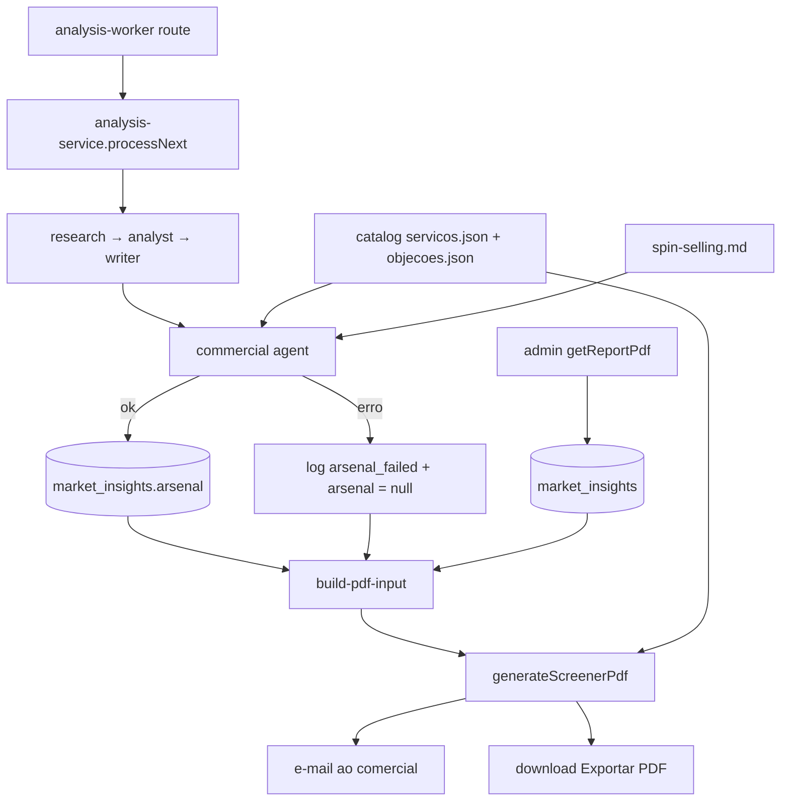

# Arsenal Comercial Design

**Spec**: `.specs/features/arsenal-comercial/spec.md`
**Context**: `.specs/features/arsenal-comercial/context.md`
**Status**: Approved (abordagem A aprovada pelo usuário em 2026-11-24)

---

## Abordagens consideradas

Todas entregam o mesmo escopo.

| # | Abordagem | Prós | Contras |
| - | --------- | ---- | ------- |
| **A (escolhida)** | Etapa `commercial` no pipeline do worker, depois do writer. Resultado em `market_insights.arsenal` (jsonb). O PDF lê o Arsenal persistido nos dois pontos de geração (worker/e-mail e `getReportPdf`). | Uma geração por relatório; e-mail e download idênticos; falha isolada; padrão já usado por `analysis`/`insights`. | Migration nova; reprocesso refaz o Arsenal junto. |
| B | Gerar o Arsenal na hora do "Exportar PDF", sem persistir. | Sem migration. | LLM em todo clique (30 a 60 s), conteúdo muda a cada download, e-mail diferente do download, falha do LLM quebra o download. |
| C | Tabela própria `commercial_arsenals` com job próprio na fila. | Versionamento e regeneração independente. | Infra a mais (fila, status, RLS) para um valor 1:1 com o lead; fora do pedido. |

Escolha A. Sub-decisão do PDF: extrair os tokens e helpers compartilhados de `report-generator.ts` para `report-primitives.ts` (A1, escolhida) em vez de anexar as páginas dentro de `report-generator.ts`, que já tem 1244 linhas (A2). A1 evita um módulo de 1700 linhas e import circular; o custo é mover código, protegido pelos 477 linhas de testes existentes.

---

## Architecture Overview



Fluxo do agente: `buildCommercialSignals(payload)` (código) + catálogo + skill SPIN + payload + analysis + insights → prompt → `generateValidatedJson` com `commercialArsenalSchema` → `CommercialArsenal`.

---

## Code Reuse Analysis

### Existing Components to Leverage

| Component | Location | How to Use |
| --------- | -------- | ---------- |
| `generateValidatedJson`, `LlmJsonError` | `src/lib/agents/llm-json.ts` | Chamada ao LLM com retry de schema (3 tentativas), como analyst/writer |
| `getLlmModel` | `src/lib/agents/llm.ts` | Modelo no wiring do worker |
| `sanitizeUntrusted`, `stripControlChars` | `src/lib/agents/sanitize.ts` | Todo texto de payload/analysis/insights no prompt |
| Padrão `clampedOptionalString` e `truncateAtWord` | `src/lib/agents/types.ts` | Copiar a técnica para `clampedString` obrigatório em `commercial-types.ts` (não exportadas hoje; não alterar `types.ts`) |
| `loadSegmentSkill` | `src/lib/agents/segment-skills.ts` | Molde do loader da skill SPIN (readFileSync em `docs/agents/skills/...`) |
| `DIMENSION_IDS`, `getDimensionById` | `src/lib/screener/contract.ts` | Enum de dimensões e nomes nas páginas |
| `shortDimensionLabel` | `src/lib/report/dimension-label.ts` | Nome curto das dimensões no PDF |
| Estilos, `sectionHeader`, `spacer`, `footer`, `p()`, `COLORS` | `src/lib/report/report-generator.ts` | Movidos para `report-primitives.ts` e reutilizados |
| `normalizeInsights` | `src/lib/agents/normalize-insights.ts` | Não usar no Arsenal; os insights entram no prompt já normalizados |
| Smoke gated por env | `src/lib/service/smoke-e2e-flow.test.ts` | Padrão `describe.skipIf` para os smokes locais |
| `describeDimension` | `src/lib/maturity/methodology.ts` | Já usado pelos dois `buildPdfInput`; passa para o builder único |

### Integration Points

| System | Integration Method |
| ------ | ------------------ |
| `analysis-service.processNext` | Nova dep opcional `orchestrator.commercial`; passo após `runPipelineWithLogs` |
| `market_insights` | Coluna `arsenal jsonb` (migration 0019); `upsert` sempre grava a chave |
| `analysis_job_logs` | Steps `arsenal` e `arsenal_failed` na constraint e em `AnalysisJobLogStep` |
| `admin-service.getReportPdf` | Parse do `arsenal` persistido com `commercialArsenalSchema.safeParse`; entra no input do PDF |
| Admin UI | `LOG_STEP_LABELS` e `LOG_ERROR_STEPS` em `src/app/admin/components.tsx` |
| Portal | Nenhuma mudança; `PortalDTO` já é montado campo a campo e não recebe `arsenal` |

---

## Components

### catalog (`src/lib/comercial/catalog.ts` + `docs/comercial/*.json`)

- **Purpose**: Carregar e validar serviços e grupos de objeção; derivar os ids.
- **Interfaces**:
  - `serviceCatalogSchema`, `objectionCatalogSchema` (strict Zod, exportados para os testes de fixtures inválidas)
  - `SERVICE_IDS: [string, ...string[]]`, `OBJECTION_GROUP_IDS: [string, ...string[]]`
  - `COMMERCIAL_CATALOG: { status: "rascunho" | "aprovado"; servicos: Service[]; grupos: ObjectionGroup[] }` (`status` é `rascunho` se qualquer arquivo for rascunho)
  - `getService(id)`, `getObjectionGroup(id)`
- **Dependencies**: `DIMENSION_IDS`; import estático dos JSON (padrão de `contract.ts`).
- **Reuses**: padrão `contract.ts`.

### Arsenal schema (`src/lib/agents/commercial-types.ts`)

- **Purpose**: `commercialArsenalSchema` e tipos; regras ARS-06..11.
- **Interfaces**: `commercialArsenalSchema`, `type CommercialArsenal`, `SPIN_STAGES`, `QUESTION_FORMATS`, `ARSENAL_LIMITS`.
- **Dependencies**: `catalog.ts` (enums), `DIMENSION_IDS`.

### Signals (`src/lib/agents/commercial-signals.ts`)

- **Purpose**: Sinais determinísticos para o prompt (ARS-12).
- **Interfaces**: `buildCommercialSignals(payload: AgentPayload): CommercialSignals` com `{ menorNivel: string[]; desequilibrio: boolean; cLevel: boolean; faixa: string; scoreValor: number; respostaComercial: string }`.
- **Reuses**: mesma regra de `detectCLevel` em `scoring.ts` (que é privada); reimplementar a regra de uma linha (`cargo.toLowerCase().includes("c-level")`) para não alterar `scoring.ts`.

### Skill SPIN (`docs/agents/skills/comercial/spin-selling.md` + `src/lib/agents/commercial-skill.ts`)

- **Purpose**: Texto do método (4 etapas, regras de boa pergunta, uso do diagnóstico) e seu loader.
- **Interfaces**: `loadSpinSkill(): string` (lança `CommercialSkillError` se não ler o arquivo).

### Commercial agent (`src/lib/agents/commercial.ts`)

- **Purpose**: Montar o prompt e devolver `CommercialArsenal` validado.
- **Interfaces**: `createCommercialAgent(deps: { llm: LanguageModel; skillLoader?: () => string; generate?: GenerateTextFn })` → `{ run(input: { payload; analysis; insights }): Promise<CommercialArsenal> }`; `class CommercialAgentError`.
- **Dependencies**: `generateValidatedJson`, catálogo, signals, sanitize.
- **Reuses**: estrutura de `writer.ts` (system prompt com regras de segurança, `<dados_*>` tags).

### PDF input builder (`src/lib/report/build-pdf-input.ts`)

- **Purpose**: Uma única função monta o `GeneratePdfInput` para o worker e para o download (ARS-40).
- **Interfaces**: `buildPdfInput(payload: AgentPayload, extras: { analysis?; insights?; arsenal? }, location?): GeneratePdfInput`.
- **Reuses**: corpo idêntico dos dois `buildPdfInput` atuais; `GeneratePdfInput` ganha `arsenal?: CommercialArsenal`.

### PDF primitives (`src/lib/report/report-primitives.ts`)

- **Purpose**: `COLORS`, `PAGE`, `p()`, `styles` compartilhados, `sectionHeader`, `spacer`, `footer`, `runningHead(sectionLabel)`; movidos sem mudar valores.
- **Reuses**: código atual de `report-generator.ts`.

### Arsenal pages (`src/lib/report/arsenal-pages.ts`)

- **Purpose**: Três `Page` do Arsenal no design system.
- **Interfaces**: `buildArsenalPages(arsenal: CommercialArsenal, catalog = COMMERCIAL_CATALOG): ReturnType<typeof React.createElement>[]` (3 páginas).
- **Layout**: página A = running head + pontos-chave (seção 01) + serviço ideal (02, card de destaque, nota de rascunho); página B = objeções (03), cards por grupo; página C = perguntas (04), lista numerada com chip de formato e etapa SPIN. Cards com `wrap: false`.

### Pipeline (`src/lib/service/analysis-service.ts`)

- **Purpose**: Chamar o agente, logar, persistir e repassar ao PDF.
- **Interfaces**: `AnalysisServiceDeps.orchestrator.commercial?(input): Promise<CommercialArsenal>`; `AgentOutput.arsenal: CommercialArsenal | null`.
- **Regras**: erro do agente → `logEvent(leadId, "arsenal_failed", message, ms)`, `arsenal = null`, fluxo segue.

---

## Data Models

```typescript
type CommercialArsenal = {
  pontos_chave: { titulo: string; texto: string; dimensao_ids: string[] }[]; // 3..5
  servico_recomendado: {
    servico_id: string; justificativa: string;
    dimensoes_atacadas: string[]; complementares?: string[]; // até 2
  };
  objecoes: { grupo: string; objecao_provavel: string; contorno: string; apoio: string }[]; // 3..6, grupo único
  perguntas: { texto: string; formato: "aberta" | "fechada";
    spin: "situacao" | "problema" | "implicacao" | "necessidade"; objetivo: string }[]; // 10
};
```

Banco (migration `0019_market_insights_arsenal.sql`): `alter table public.market_insights add column if not exists arsenal jsonb;` (nullable, sem default) e `analysis_job_logs_step_check` recriada com os 12 steps atuais mais `'arsenal'`, `'arsenal_failed'`. `MarketInsightsRow.arsenal?: unknown` (opcional na interface para não quebrar fixtures existentes).

Catálogo (`servicos.json`): `{ versao: "0.1", status, servicos: [{ id, nome, resumo, dimensoes, quando_indicar }] }`. `objecoes.json`: `{ versao: "0.1", status, grupos: [{ id, nome, descricao }] }`.

---

## Error Handling Strategy

| Error Scenario | Handling | User Impact |
| -------------- | -------- | ----------- |
| LLM do Arsenal devolve JSON inválido ou fora do schema 3 vezes | `CommercialAgentError`; `processNext` loga `arsenal_failed`, grava `arsenal = null` | PDF sai sem Arsenal; log vermelho no admin |
| LLM indisponível (rede, 5xx) | Mesmo caminho | Idem |
| Skill SPIN ilegível | `CommercialAgentError` antes de chamar o LLM | Idem |
| `logEvent` do `arsenal_failed` falha | `console.error` e segue (padrão `logEventSafe`) | Nenhum |
| Arsenal persistido não valida (catálogo mudou) | `getReportPdf` omite o Arsenal e segue | PDF sem Arsenal |
| Falha no research/analyst/writer | Fluxo atual (retry, fallback); agente comercial não roda | PDF básico, como hoje |
| Falha ao renderizar páginas do Arsenal | Propaga como falha de PDF atual (`pdf_failed`) | Igual a qualquer falha de PDF |

---

## Risks & Concerns

| Concern | Location (file:line) | Impact | Mitigation |
| ------- | -------------------- | ------ | ---------- |
| `buildPdfInput` duplicado em dois serviços | `src/lib/service/analysis-service.ts:63`, `src/lib/service/admin-service.ts:37` | E-mail e download divergem (viola ARS-40) | Extrair `build-pdf-input.ts` antes de adicionar o Arsenal; testes comparam os dois caminhos |
| `report-generator.ts` com 1244 linhas e estilos num único `StyleSheet` | `src/lib/report/report-generator.ts:1` | Páginas novas inflam o arquivo ou geram import circular | `report-primitives.ts` com mover-sem-mudar; testes existentes como rede de segurança |
| Worker importa agentes dinamicamente e tem `require` inline | `src/app/api/analysis-worker/route.ts:20` | Wiring novo pode seguir o padrão frágil | Copiar o padrão `await import(...)` dos agentes vizinhos; não refatorar o restante |
| Pipeline ganha mais uma chamada de LLM (~30 a 60 s) | `src/lib/service/analysis-service.ts:289` | Job mais longo | Dentro do VT de 600 s e do limite stale de 30 min; falha isolada |
| `loadSegmentSkill` lê `docs/` por `process.cwd()` | `src/lib/agents/segment-skills.ts:11` | Em produção a pasta `docs/` precisa existir na imagem | Mesmo caminho já usado pelas skills de segmento; skill SPIN falha de forma isolada (`arsenal_failed`) se faltar |
| Catálogo seed é inventado pelo planejador | `docs/comercial/servicos.json` | Vendedor oferta serviço que a Rhema não vende | `status: "rascunho"` + nota no PDF (ARS-35) até o dono enviar o catálogo real |
| Cobertura: nenhum teste do worker route | `src/app/api/analysis-worker/route.ts` | Wiring do agente comercial sem teste unitário | Coberto pelo smoke local gated (T25) e pelo teste do serviço |
| LLM pode ignorar o guardrail e inventar casos | prompt do agente | Promessa falsa na mão do vendedor | Regra explícita no prompt (teste do texto) e conferência humana da saída real na etapa de verificação |

---

## Tech Decisions (only non-obvious ones)

| Decision | Choice | Rationale |
| -------- | ------ | --------- |
| Onde guardar o Arsenal | Coluna `jsonb` em `market_insights` | 1:1 com o lead, mesmo ciclo de `analysis`/`insights`; reprocesso sobrescreve |
| Falha do Arsenal | Isolada, sem retry de job | O Arsenal é extra; não pode reabrir o pipeline principal nem duplicar e-mail |
| Enums de serviço/grupo | `z.enum` derivado dos JSON | Trocar o catálogo é mudança de dado; id inválido do LLM vira retry |
| Sinais | Calculados em código | O LLM não decide o que já é determinístico (risco, desequilíbrio, C-level) |
| Páginas | 3 `Page` explícitas com cards `wrap: false` | Contagem de páginas previsível (ARS-27, ARS-37); `ARSENAL_LIMITS` calibrado para o teto (5 pontos, 6 objeções, 10 perguntas) caber em 3 páginas |
| Conferência visual | `scripts/pdf-to-png.swift` (PDFKit do macOS, validado no ambiente) | Não há `pdftoppm`, `mutool` nem `magick`; zero dependência nova |
| Smokes locais | `describe.skipIf` por env, no padrão do repo | Suíte padrão continua determinística e sem custo de LLM |
| Entrega local do PDF real | Smoke com `sendEmail` no-op | Chaves de LLM/Exa/Resend são reais; nenhum e-mail pode sair |

Decisões de projeto registradas em `.specs/STATE.md`: AD-013 (Arsenal é interno e fora do portal) e AD-014 (Arsenal persistido em `market_insights.arsenal`, falha isolada).
