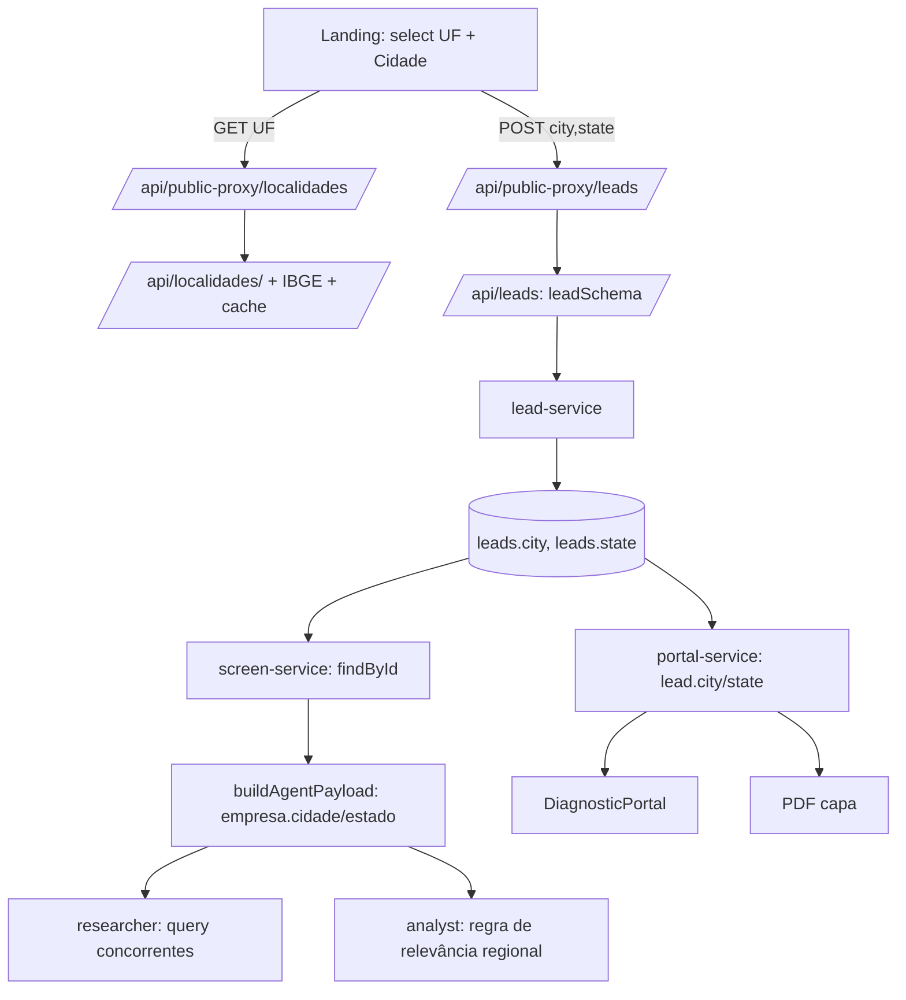

# Localização da Empresa para Busca de Concorrentes Design

**Spec**: `.specs/features/localizacao-concorrentes/spec.md`
**Status**: Draft

---

## Architecture Overview

A localização nasce no cadastro da landing, é gravada em `leads` e viaja por duas rotas: o `agent_payload` (busca e análise) e o DTO do portal (exibição). A lista de municípios vem do IBGE, buscada no servidor por uma rota proxy pública, com cache em memória.



Decisão de abordagem: o IBGE é chamado no servidor (spec, assumption "Onde a API do IBGE é chamada"). A alternativa, chamar do browser, exigiria liberar `servicodados.ibge.gov.br` na CSP e foge do padrão "frontend só chama proxy" (AGENTS.md 8.3).

Restrição de AD vigente: AD-005 (credenciais server-side) não é afetada, pois o IBGE é público e sem chave. Nenhuma decisão ativa é substituída.

---

## Code Reuse Analysis

### Existing Components to Leverage

| Component | Location | How to Use |
| --- | --- | --- |
| `leadSchema` | `src/lib/schemas/lead.ts` | Estender com `state` e `city`, mantendo `.strict()` |
| `sanitizeText` | `src/lib/schemas/lead.ts` | Aplicar em `city` na rota `/api/leads` |
| `createLeadService` | `src/lib/service/lead-service.ts` | Receber `city`/`state` e atualizar o lead pendente reaproveitado |
| `createLeadRepository` | `src/lib/repository/lead-repo.ts` | Incluir `city`/`state` em `create`, nos `select` de `findById`/`findByEmail` e num novo `updateLocation` |
| `proxyToInternal` | `src/lib/auth/proxy.ts` | Rota `public-proxy/localidades` (GET) |
| `RATE_LIMITS` | `src/middleware.ts` | Nova entrada para `/api/public-proxy/localidades` |
| `sanitizeUntrusted` | `src/lib/agents/sanitize.ts` | Sanitizar cidade/UF na query e no prompt |
| `buildAgentPayload` | `src/lib/screener/agent-payload.ts` | Novo parâmetro `location` |
| `agentPayloadSchema` | `src/lib/schemas/agent-payload.ts` | Campos `cidade`/`estado` opcionais e nullable |
| `portalDTOSchema` | `src/lib/dto/portal.ts` | `lead.city`/`lead.state` opcionais |
| Select/`rd-input` da landing | `src/app/page.tsx` | Mesmo estilo do select de cargo |

### Integration Points

| System | Integration Method |
| --- | --- |
| IBGE Localidades | `GET https://servicodados.ibge.gov.br/api/v1/localidades/estados/{UF}/municipios?orderBy=nome`, resposta `[{ id, nome, ... }]` (verificada: SP devolve 645 itens) |
| Supabase `leads` | Migration `0018` adiciona `city` e `state` nullable, com `check` das 27 UFs em `state` |
| Exa | Só muda o texto da query de `concorrentes` |

---

## Components

### Constante de UFs

- **Purpose**: Fonte única das 27 UFs (sigla e nome) para select e validação.
- **Location**: `src/lib/localidades/estados.ts`
- **Interfaces**:
  - `ESTADOS: readonly { sigla: UF; nome: string }[]`
  - `UF_SIGLAS: [UF, ...UF[]]` - tupla para `z.enum`
- **Dependencies**: nenhuma (importável no client e no server).

### Serviço de municípios (servidor)

- **Purpose**: Buscar municípios de uma UF no IBGE com cache, timeout e validação do formato.
- **Location**: `src/lib/service/localidades-service.ts`
- **Interfaces**:
  - `createLocalidadesService({ fetchImpl?, now? })`
  - `listMunicipios(uf: UF): Promise<string[]>` - nomes em ordem alfabética; lança `LocalidadesServiceError(502)` em falha, timeout (4 s) ou payload fora do formato (`z.array(z.object({ nome: z.string() }))`)
- **Dependencies**: `fetch`; cache `Map<UF, { expiresAt, nomes }>` em módulo, TTL de 24 h.
- **Reuses**: padrão de erro tipado dos demais services.

### Rota interna e proxy de localidades

- **Purpose**: Expor os municípios ao browser sem chamar o IBGE de lá.
- **Location**: `src/app/api/localidades/route.ts` (interna) e `src/app/api/public-proxy/localidades/route.ts`
- **Interfaces**:
  - `GET /api/localidades?uf=SP` → `200 { municipios: string[] }`; `400` para UF inválida (`z.enum(UF_SIGLAS).safeParse`); `502 { error: "Serviço de localidades indisponível" }`; `401` sem chave interna
  - Proxy repassa a query string (`proxyToInternal` hoje não a repassa; ver Risks)
- **Reuses**: `verifyInternalApiKey`, `proxyToInternal`.

### Schema e rota de leads

- **Purpose**: Validar e persistir `state` e `city`.
- **Location**: `src/lib/schemas/lead.ts`, `src/app/api/leads/route.ts`, `src/lib/service/lead-service.ts`, `src/lib/repository/lead-repo.ts`
- **Interfaces**:
  - `leadSchema` ganha `state: z.enum(UF_SIGLAS)` e `city: z.string().trim().min(2).max(80).refine(sem < ou >)`
  - `leadService.createLead({ ..., city, state })`: no ramo "lead pendente existente" chama `leadRepo.updateLocation(id, { city, state })` antes de devolver o id
  - `leadRepo.create` grava `city`/`state`; `findById` e `findByEmail` selecionam `city, state`
- **Reuses**: fluxo atual de duplicidade (409 para concluído).

### Formulário da landing

- **Purpose**: Select de Estado, select de Cidade dependente, fallback de texto livre.
- **Location**: `src/app/page.tsx`, `src/lib/api/client.ts` (`getMunicipios(uf)`, `LeadInput` com `city`/`state`), `src/lib/lead-storage.ts` (`city`/`state` opcionais em `StoredLead`)
- **Interfaces**:
  - `getMunicipios(uf: string): Promise<string[]>` → `GET /api/public-proxy/localidades?uf=UF`
  - Estado: troca de UF limpa a cidade e dispara a busca; falha → `cityFallback = true` e a Cidade vira `<input type="text">`
  - Validação client: `Informe o estado` / `Informe a cidade`
- **Reuses**: `update`/`errors` do formulário atual.

### Payload dos agentes

- **Purpose**: Levar a localização do lead aos agentes.
- **Location**: `src/lib/screener/agent-payload.ts`, `src/lib/schemas/agent-payload.ts`, `src/lib/service/screen-service.ts`
- **Interfaces**:
  - `AgentPayloadInput.location?: { cidade: string | null; estado: string | null }`
  - `AgentPayload.empresa.cidade` e `.estado`: `string | null`
  - `agentPayloadSchema.empresa.cidade/estado`: `z.string().nullable().optional()` (leads antigos sem a chave continuam válidos)
  - `screen-service`: no ramo com `leadId`, passa `{ cidade: lead.city, estado: lead.state }`; no ramo de fallback por e-mail, passa `null`/`null`
- **Reuses**: `leadRepo.findById` já chamado no submit.

### Researcher

- **Purpose**: Query de concorrentes regional.
- **Location**: `src/lib/agents/researcher.ts` (`buildQueries`)
- **Interfaces**: com `nome`, `cidade` e `estado`: `"{nome} concorrentes em {cidade} {estado} análise de dados — {nome} competitors in {cidade}, {estado}, Brazil data analytics"`. Qualquer um dos três ausente mantém a query atual. `cidade` e `estado` passam por `sanitizeUntrusted(valor, 80)`.
- **Reuses**: `sanitizeUntrusted`.

### Analyst

- **Purpose**: Restringir relevância regional.
- **Location**: `src/lib/agents/analyst.ts` (`buildPrompt`)
- **Interfaces**: `payload.empresa` já é serializado em `<dados_empresa>`; com `cidade` e `estado` presentes, acrescenta a regra: "priorize concorrentes que atuam em {cidade}/{estado}; quando o concorrente for de outra região, diga isso em `contexto`". Sem localização, o prompt não muda.

### Portal e PDF

- **Purpose**: Exibir "Cidade/UF".
- **Location**: `src/lib/dto/portal.ts`, `src/lib/service/portal-service.ts`, `src/components/portal/DiagnosticPortal.tsx`, `src/lib/report/report-generator.ts` e o ponto que monta `GeneratePdfInput`
- **Interfaces**:
  - `portalDTOSchema.lead` ganha `city: z.string().nullable().optional()` e `state` idem
  - `portal-service` preenche a partir de `lead.city`/`lead.state`
  - `DiagnosticPortal`: linha `"{name} · {n} dimensões avaliadas · {city}/{state}"` quando ambos existem
  - PDF: linha na capa junto à empresa, omitida sem localização
- **Reuses**: `meta` e estilos existentes.

---

## Data Models

### `leads` (migration `supabase/migrations/0018_lead_location.sql`)

```sql
alter table public.leads
  add column city text,
  add column state text;

alter table public.leads
  add constraint leads_state_uf_check
  check (state is null or state in ('AC','AL','AP','AM','BA','CE','DF','ES','GO','MA','MT','MS','MG','PA','PB','PR','PE','PI','RJ','RN','RS','RO','RR','SC','SP','SE','TO'));
```

**Relationships**: nenhuma nova; `docs/data-model.md` recebe as duas colunas.

### Payload

```typescript
empresa: {
  nome: string | null;
  porte: string | null;
  segmento: string | null;
  funcionarios: string | null;
  faturamento: string | null;
  cidade?: string | null;
  estado?: string | null;
}
```

---

## Error Handling Strategy

| Error Scenario | Handling | User Impact |
| --- | --- | --- |
| `state` ou `city` inválidos em `/api/leads` | 400 `{ error: "Dados inválidos", issues }` | Erro no campo |
| IBGE indisponível, lento ou fora do formato | `502` da rota; UI cai no texto livre | Cadastro continua |
| UF inválida em `/api/localidades` | 400 | Nenhum (UI só envia UFs da constante) |
| Lead antigo sem localização | `cidade`/`estado` nulos; query e prompt antigos | Nenhum |

## Tech Decisions

| Decision | Choice | Rationale |
| --- | --- | --- |
| Cache de municípios | `Map` em módulo, TTL 24 h | Lista muda raramente; evita chamadas repetidas ao IBGE; sem nova infra |
| Cidade não validada contra a UF no servidor | Só formato | O IBGE pode estar fora do ar; a validação seria fail-open de qualquer jeito |
| Estado com `check` no banco | 27 UFs em SQL | Defesa em profundidade além do Zod |
| Rate limit da rota de localidades | 60 req/min por IP | Uso normal é 1 chamada por troca de UF; mais folgado que o de leads |

---

## Risks & Concerns

| Concern | Type | Mitigation |
| --- | --- | --- |
| `proxyToInternal` não repassa a query string (`?uf=`) | Fragile code | Tarefa própria: repassar `search` do request ao `targetUrl`, com teste; a mudança é aditiva e não afeta POSTs existentes |
| Cache em memória por instância (Coolify pode ter mais de uma réplica) | Performance | Aceitável: cada réplica busca uma vez por UF a cada 24 h |
| Rota pública que dispara chamada externa pode virar vetor de abuso | Security | `uf` restrita a 27 valores (no máximo 27 chaves de cache), rate limiting no middleware, timeout de 4 s |
| Fila e banco compartilhados entre local e prod (memória do projeto) | Operational | A migration `0018` é aplicada manualmente e só com autorização explícita. Os `select` de `leads` passam a pedir `city`/`state`, então um deploy sem a migration quebra a leitura de leads: a ordem é migration primeiro, deploy depois |
| `LeadRow` é usado em vários testes e fixtures | Test coverage | Campos `city`/`state` opcionais no tipo; fixtures existentes não precisam mudar |
| Sem teste do researcher cobrindo a query de concorrentes com localização | Test coverage gap | Cobrir nas tarefas do researcher |
