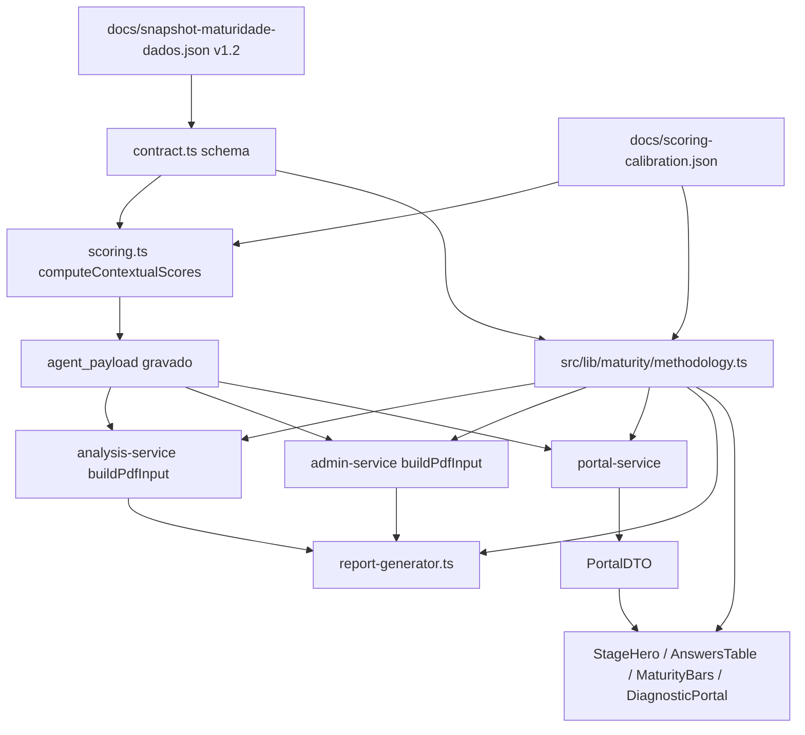

# Metodologia DMBOK2 Design

**Spec**: `.specs/features/metodologia-dmbok2/spec.md`
**Status**: Approved

---

## Architecture Overview

Mudança de dados + um módulo de apresentação compartilhado. Nenhuma camada nova, rota, tabela ou dependência.



## Code Reuse Analysis

| Component | Location | How to Use |
| --------- | -------- | ---------- |
| `SCREENER_CONTRACT`, `getDimensionById` | `src/lib/screener/contract.ts` | Fonte de `escala_niveis`, `referencia`, `area_dmbok` |
| `SCORING_CALIBRATION` | `src/lib/screener/scoring-calibration.ts` | Fonte de `base_weight` |
| `computeContextualScores` | `src/lib/screener/scoring.ts:123` | Trocar a substituição de `scoring.faixas` por descrição setorial |
| `getRecalibratedBands` | `src/lib/screener/weight-calculator.ts` | Continua retornando as faixas do segmento; usadas só para `descricao` |
| `buildPdfInput` | `src/lib/service/analysis-service.ts:54`, `src/lib/service/admin-service.ts:37` | Enriquecer dimensões com `describeDimension` |
| Portal mapping | `src/lib/service/portal-service.ts` (montagem de `dimensions`) | Enriquecer com `describeDimension` |

## Components

### `src/lib/maturity/methodology.ts` (novo)

- **Purpose**: única fonte dos textos e formatos metodológicos usados por PDF e portal.
- **Interfaces**:
  - `INDEX_LABEL: string` = `"Índice de Maturidade Rhema · base DAMA-DMBOK2"`
  - `SCALE_LEGEND: string` = `"Escala de níveis (DAMA-DMBOK2): " + escala_niveis.map(n => \`${n.nivel} ${n.rotulo}\`).join(" · ")`
  - `METHOD_NOTE: string` = `SCREENER_CONTRACT.meta.referencia`
  - `formatWeight(peso: number, pesoPadrao: number): string`
  - `formatScore(valor: number): string` → `valor.toFixed(1).replace(".", ",") + " de 5"`
  - `getBaseWeight(id: string): number | null`
  - `getAreaDmbok(id: string): string | null`
  - `describeDimension(id: string, peso: number): { pesoPadrao: number; areaDmbok: string }`
- **Constraints**: sem `server-only` e sem `process.env` (importado por componentes client). Só importa `contract.ts` e `scoring-calibration.ts`, que são JSON validado.

### Contrato (`docs/snapshot-maturidade-dados.json` + `contract.ts`)

- `metaSchema` ganha `nome_indice: z.string()`, `referencia: z.string()`, `escala_niveis: z.array(z.object({ nivel: z.number().int().min(1).max(5), rotulo: z.string().min(1) })).length(5)`.
- `meta.escala` passa a `"DAMA-DMBOK2 (cap. 15): 1 Inicial · 2 Repetível · 3 Definido · 4 Gerenciado · 5 Otimizado"`.
- Rótulos `area_dmbok` e 4 opções de nível 3 conforme MET-04 e MET-06.

### Scoring (`scoring.ts`)

`computeContextualScores` deixa de passar `recalibratedBands` como `scoring.faixas`. Passa os pesos ajustados, classifica com `contract.scoring.faixas` e, depois, troca `band.descricao` pela descrição da faixa setorial com o mesmo `rotulo`, quando existir. A seed JSON tem os `min/max` de `recalibrated_bands` igualados aos do contrato (MET-12); o schema da calibração não muda, para manter válidas as versões já gravadas em `scoring_versions`.

### Tipos de dados

```typescript
// GeneratePdfInput.dimensionScores (screen-service.ts)
{ name: string; nivel: number; peso: number; pesoPadrao: number; areaDmbok: string }[]

// PortalDTO.dimensions[n] (dto/portal.ts) ganha
pesoPadrao: z.number().positive(), areaDmbok: z.string()
```

## Error Handling Strategy

| Error Scenario | Handling | User Impact |
| -------------- | -------- | ----------- |
| Dimensão sem `base_weight` ou sem `area_dmbok` | `describeDimension` cai para `peso` e `""` | Linha mostra "X% (padrão)" sem área |
| Calibração do banco com faixas setoriais antigas | Limites ignorados; só `descricao` é usada | Estágio consistente com a régua |
| Contrato inválido (ex.: `escala_niveis` com 4 itens) | `screenerContractSchema.parse` falha no load (fail fast, já existente) | Build/teste quebra antes do deploy |

## Risks & Concerns

| Concern | Location | Impact | Mitigation |
| ------- | -------- | ------ | ---------- |
| Testes existentes assumem faixas setoriais (ex.: `weight-calculator.test.ts:196`, `scoring-calibration.test.ts:105`) | testes citados | Falham após MET-07/MET-12 | Atualizar só as asserções que codificavam o comportamento antigo, citando o MET correspondente |
| Testes de snapshot/strings do PDF e portal citam "CMMI", "SCORE", escala antiga | `report-generator.test.ts`, `StageHero.test.tsx` | Falham | Mesmo tratamento: atualizar para o novo texto da spec |
| `methodology.ts` importado em client | componentes do portal | Bundle inclui JSON da calibração (~10 KB) | Aceitável; o contrato já é importado no client |

## Tech Decisions

| Decision | Choice | Rationale |
| -------- | ------ | --------- |
| Onde ficam os textos | Contrato JSON (`meta`) + `methodology.ts` | Contrato continua a fonte de verdade (AGENTS.md §4.1) |
| Faixas setoriais | Mantidas no schema, limites ignorados | Compatível com `scoring_versions` em produção sem migração |
